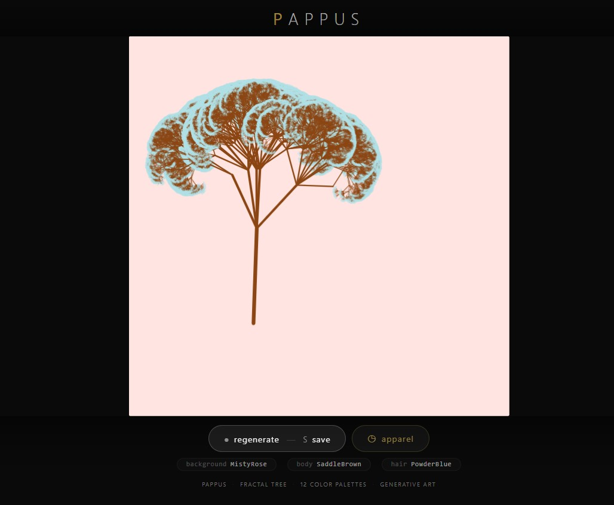
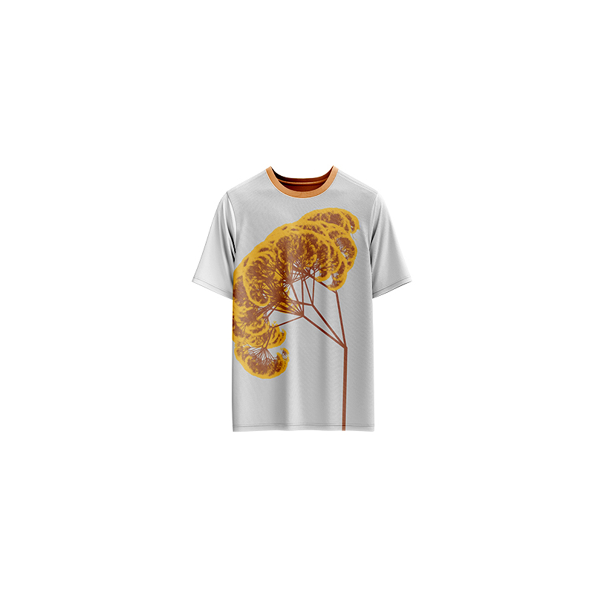

# Pappus — Generative Art

[](https://reyrove.github.io/Pappus-Generative-Art)
[](https://opensource.org/licenses/MIT)

> **Generative fractal tree art with 12 unique color palettes.** Each refresh creates a unique Pappus tree with randomly selected colors, branch patterns, and organic growth. Named after the Pappus tree fractal pattern.

## 🎨 Live Demo

<div align="center">
  <a href="https://reyrove.github.io/Pappus-Generative-Art" target="_blank">
    
  </a>
  <br><br>
  <a href="https://reyrove.github.io/Pappus-Generative-Art" target="_blank">
    
  </a>
  <br>
  <em>Click the image or button to experience the generative art</em>
</div>

## 👕 Apparel Preview

<div align="center">
  
  <br>
  <em>Pappus artwork printed on a T-shirt</em>
</div>

## ✨ Features

- **Fractal Tree** — Recursive branching algorithm with 9 levels of depth
- **12 Color Palettes** — Unique combinations of background, body, and hair colors
- **Organic Growth** — Random branching patterns create natural-looking trees
- **Color Gradients** — Smooth transitions between body and hair colors
- **Unique Every Time** — Random seed ensures each composition is one-of-a-kind
- **Save & Share** — Download as PNG
- **Apparel Mode** — Preview artwork on a T-shirt mockup
- **Responsive** — Works on desktop, tablet, and mobile
- **Pure JavaScript** — Built without external libraries
- **Keyboard Shortcuts**:
  - `R` — Regenerate
  - `S` — Save image
  - `T` — Toggle apparel view
  - `Space` — Regenerate

## 🎨 Artwork Details

| Parameter | Range | Description |
|-----------|-------|-------------|
| **Tree Depth** | 9 levels | Recursive branching depth |
| **Branch Sub-branches** | 1–12 | Random branches per node |
| **Color Palettes** | 12 options | Background, Body, Hair colors |
| **Branch Angle** | Variable | Random angle variation |
| **Branch Length** | 0.618× | Fibonacci-like scaling |
| **Branch Width** | 0.618× | Proportional scaling |
| **Start Position** | Random | Tree base location |

## 🎯 Color Palettes

### Background Colors
| Name | Hex |
|------|-----|
| Cornsilk | #FFF8DC |
| Wheat | #F5DEB3 |
| Beige | #F5F5DC |
| Gainsboro | #DCDCDC |
| Snow | #FFFAFA |
| LightCyan | #E0FFFF |
| Bisque | #FFE4C4 |
| LavenderBlush | #FFF0F5 |
| MistyRose | #FFE4E1 |
| Plum | #DDA0DD |
| AliceBlue | #F0F8FF |
| Pastel Light Blue | #D5D6EA |

### Body Colors
| Name | Hex |
|------|-----|
| Sienna | #A0522D |
| DarkOliveGreen | #556B2F |
| SteelBlue | #4682B4 |
| SaddleBrown | #8B4513 |
| Maroon | #800000 |
| Chocolate | #D2691E |
| Purple Iris | #571B7E |
| Pastel Violet | #D291BC |
| Pastel Orange | #F8B88B |
| Dark Yellow | #8B8000 |
| Neon Yellow | #FFFF33 |
| Dragon Green | #6AFB92 |

### Hair Colors
| Name | Hex |
|------|-----|
| MediumSpringGreen | #00FA9A |
| CadetBlue | #5F9EA0 |
| PowderBlue | #B0E0E6 |
| SandyBrown | #F4A460 |
| Silver | #C0C0C0 |
| HoneyDew | #F0FFF0 |
| RosyBrown | #BC8F8F |
| Bright Turquoise | #16E2F5 |
| Neon Gold | #FDBD01 |
| Mahogany | #C04000 |
| Deep Red | #800517 |
| Blush Red | #E56E94 |

## 🚀 Quick Start

### Local Development

```bash
# Clone the repository
git clone https://github.com/reyrove/Pappus-Generative-Art.git

# Navigate to the directory
cd Pappus-Generative-Art

# Open in browser
open index.html
# or use a live server
```

### Deploy to GitHub Pages

1. Push to GitHub
2. Go to Settings → Pages
3. Select branch `main` and root folder
4. Your site will be live at `https://reyrove.github.io/Pappus-Generative-Art`

## 🧠 How It Works

The artwork is generated using a recursive fractal tree algorithm:

1. **Setup**:
   - Random background color from 12 options
   - Random body color from 12 options
   - Random hair color from 12 options
   - Random starting position and angle

2. **Tree Generation**:
   - Start with a single branch at the base
   - Each branch splits into 1–12 sub-branches
   - Branch length and width scale by 0.618× (golden ratio inverse)
   - Random angle variation creates organic shapes
   - Recurses 9 levels deep

3. **Rendering**:
   - Hair color for outer branches (depth ≤ 1)
   - Body color for inner branches (depth > 1)
   - Creates a natural color gradient from center to tips
   - Smooth, rounded line caps

## 📁 File Structure

```
Pappus-Generative-Art/
├── index.html          # Main application (all-in-one)
├── Pappus.jpg          # T-shirt mockup image
├── fav.svg             # Favicon
├── demo-screenshot.jpg # Website demo screenshot
├── README.md           # This file
└── LICENSE             # MIT License
```

## 🛠️ Tech Stack

- **Pure JavaScript** — No external libraries
- **Canvas API** — 2D rendering
- **CSS Flexbox/Grid** — Responsive layout
- **GitHub Pages** — Hosting

## 🎯 Interactive Controls

| Action | Keyboard | Button |
|--------|----------|--------|
| Regenerate | `R` or `Space` | Click "regenerate" |
| Save Image | `S` | Click "regenerate" |
| Toggle Apparel | `T` | Click "apparel" |

## 🎨 The Creative Process

### Fractal Tree Algorithm
The Pappus tree uses a recursive branching algorithm inspired by natural tree growth. Each branch splits into multiple sub-branches with random angles, creating organic and unique patterns every time.

### Golden Ratio Scaling
Branch length and width scale by 0.618× (the inverse of the golden ratio) at each level, creating mathematically pleasing proportions that mimic natural growth patterns.

### Color Selection
Three independent color palettes (background, body, and hair) are randomly selected from 12 options each, creating 1,728 possible color combinations. The body and hair colors blend naturally through the tree structure.

### Organic Variation
Random angles, branch counts, and starting positions ensure that each generated tree is completely unique, even with the same color palette.

## 📱 Responsive Design

The application automatically adapts to:
- Desktop screens
- Tablets
- Mobile phones
- Landscape orientation
- Various aspect ratios
- Small screens (down to 380px wide)

## 🤝 Contributing

Contributions are welcome! Feel free to:
- Fork the repository
- Create a feature branch
- Submit a pull request

### Ideas for Contributions:
- Additional color palettes
- New tree growth patterns
- Animation features
- Interactive controls
- Performance optimizations
- More apparel mockups

## 📄 License

MIT License — see [LICENSE](LICENSE) file for details.

## 🙏 Acknowledgments

- Inspired by fractal tree algorithms and natural patterns
- Named after the Pappus tree fractal
- Special thanks to the creative coding community

---

**Built with ❤️ and fractal dreams**